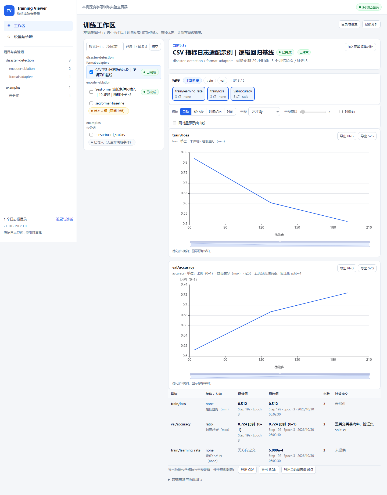
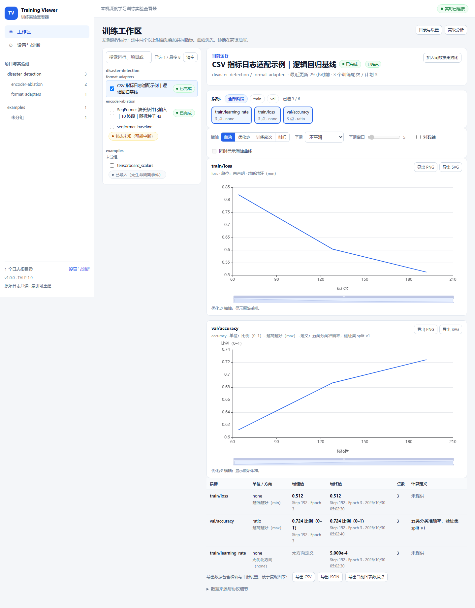
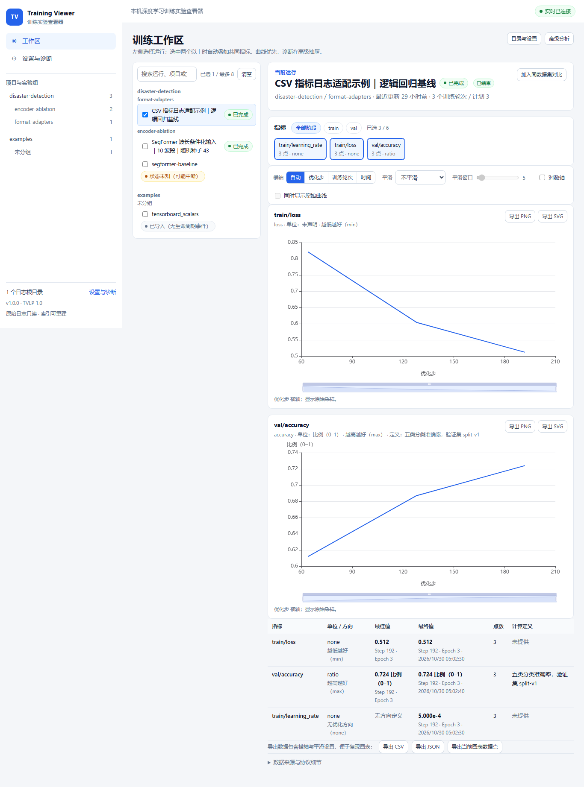
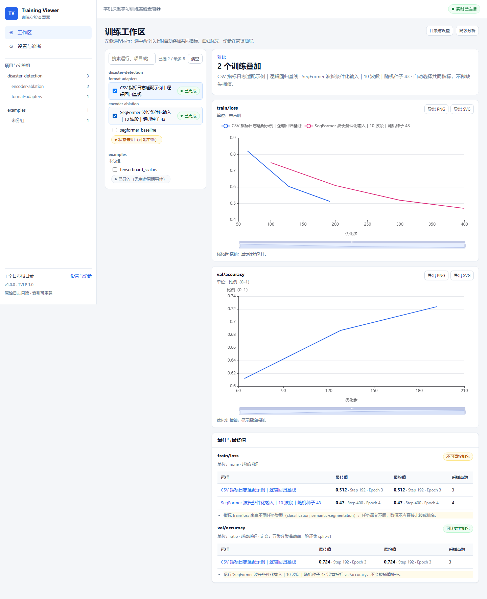

# Training Viewer 训练实验查看器（V1.0.0）

在本机安装、浏览器访问的深度学习训练实验查看器。它**只读取**训练程序写出的日志文件，实时显示曲线，管理项目 / 实验组 / 单次运行，比较多个实验，并浏览预测图、标签图和混淆矩阵等结果。训练程序不需要联网，也不需要依赖查看器服务。

- 日志协议：Training Viewer Log Protocol（TVLP）1.0，见 [`schemas/`](schemas/)。
- 运行方式：本机 `127.0.0.1`，单用户；不监听公网，不需要数据库服务器。
- 数据边界：原始日志只读；`index.sqlite3` 只保存可重建的指标索引；根目录、备注、收藏、保存视图在 `user_state.sqlite3`，删除索引不会清空。



## 已有训练日志：直接打开（零改造）

如果训练已经跑过，日志是 TensorBoard 事件文件、CSV/TSV/JSONL，或普通的 `train.log` / `train.txt`，不需要改训练代码，也不需要先接写入器：

```powershell
training-viewer open D:\experiments\projectA
```

打开后首页直接显示**最近一次训练**的真实损失/验证指标曲线；没有数据时会明确说明原因，而不是只显示文件夹列表。目录、诊断和协议细节收在“高级设置 / 设置与诊断”中。

支持两类接入方式，按需要选择：

| 场景 | 做法 | 是否需要改训练代码 |
|---|---|---|
| 已有日志 | 直接 `training-viewer open <目录>`，或在首页/设置页添加目录 | 不需要 |
| 新实验、希望状态/心跳/产物更完整 | 使用 `TrainingRunWriter` + `attach`，见下一节 | 需要，但只是可选增强 |

## 新实验：让训练 Agent 自动接入（可选增强）

如果希望查看器能证明“训练进程仍在运行”、记录断点续训会话、统一产物路径，把 [`AGENT_INTEGRATION.md`](AGENT_INTEGRATION.md) 完整交给训练 Agent，它应当：

1. 在训练代码中调用 `TrainingRunWriter`（只依赖 Python 标准库，可用 `pip install training-viewer` 或直接复制 `src/training_viewer/writer.py`）；
2. 按 TVLP 1.0 生成 `run.json`、`metrics.jsonl`、`events.jsonl` 和 `artifacts/`；
3. **在训练开始前**运行 `training-viewer attach <日志根目录> --json`，在后台启动并挂载查看器，训练过程中曲线会自动刷新；
4. 训练结束后运行 `training-viewer validate <run目录>`，确认 0 error；
5. 把返回的 `url` 交给你。

真实训练中顺序建议：

```text
创建日志根目录 → attach（后台）→ 启动训练 → 写指标/心跳/产物 → 训练结束 → validate → 交付 URL
```

Agent 侧核心命令只有：

```powershell
training-viewer attach D:\runs\my-project --json
```

成功后会返回 `status: "ok"` 和 `http://127.0.0.1:8765/`。查看器在后台运行，Agent 会话结束也不会停止；需要时用 `training-viewer status --json` 检查，用 `training-viewer stop` 停止。

给训练 Agent 的一句话：

```text
请完整阅读并遵守 AGENT_INTEGRATION.md：在当前训练项目中加入 TrainingRunWriter，
按 TVLP 1.0 写出真实指标与产物，运行 training-viewer validate 确认 0 error，
再运行 training-viewer attach <日志根目录> --json，把返回的 url 交给我。
```

## 目录

- [能做什么](#能做什么)
- [快速开始](#快速开始)
- [使用流程](#使用流程)
- [命令行](#命令行)
- [VS Code 扩展](#vs-code-扩展)
- [支持的日志来源](#支持的日志来源)
- [数据、安全与实时性](#数据安全与实时性)
- [示例数据](#示例数据)
- [开发与测试](#开发与测试)
- [已知限制](#已知限制)
- [文档与术语](#文档与术语)

## 能做什么

| 功能 | 页面 | 说明 |
|---|---|---|
| 项目 / 实验组 / 运行管理 | 训练工作区 / 设置与诊断 | 左树按项目/实验组组织；搜索、多选、状态/指标摘要；高级筛选在设置页 |
| 实时曲线 | 训练工作区 | 左侧选 Run，右侧直接显示当前/最近训练的 Loss 与验证指标；按真实数据自动选择优化步或训练轮次，不伪造 Step |
| 多实验对比 | 训练工作区 | 左树勾选第二个 Run 即自动叠加共同指标；不跳转独立比较页，不插值；不可排名时显示原因 |
| 逻辑实验 | 训练工作区 / 设置与诊断 | 默认一文件一 Run；用户确认后可将同目录多文件归并为一个逻辑实验，sidecar 可撤销 |
| 预测结果对照 | 运行页 / 预测结果 | 运行页内嵌最新预测样本；完整图库按样本和 Epoch 并排显示原图、真实标签、预测 |
| 配置与来源 | 配置与来源 | run.json 的模型、数据集、超参数、代码来源、指标定义 |
| 时间线与诊断 | 时间线 / 设置与诊断 | 生命周期、心跳、产物事件；坏行、缺失产物、Step 回退、状态未知原因；活动与生命周期状态分开显示 |
| 日志格式适配 | 日志来源 | 标准 TVLP、TensorBoard 事件文件（可选依赖）、CSV 指标表、任意文件名 CSV/TSV/JSONL、普通文本日志 |
| 插件扩展 | — | 日志来源适配器、导出器、前端产物视图均有显式注册表；第三方来源可通过 Python entry point 安装 |
| 训练侧接入 | — | `TrainingRunWriter`（仅标准库）、Agent 接入契约、后台 `attach`；仅新实验需要 |
| 入口 | — | `training-viewer open/serve/validate/attach/status/stop`、实例复用、VS Code 扩展与 VSIX |
| 插件扩展 | — | 日志来源适配器、导出器、前端产物视图均有显式注册表；第三方来源可通过 Python entry point 安装 |
| 训练侧接入 | — | `TrainingRunWriter`（仅标准库）、Agent 接入契约、后台 `attach` |
| 入口 | — | `training-viewer open/serve/validate/attach/status/stop`、实例复用、VS Code 扩展与 VSIX |

## 快速开始

### 环境要求

- Python 3.11 或更高版本。
- Windows、Linux 或 macOS；本文命令以 PowerShell 为例。
- 只有重新构建前端时才需要 Node.js 20+。安装包里已经包含构建好的前端资源。

### 从源码安装

```powershell
cd training_viewer_v1
python -m venv .venv
.\.venv\Scripts\Activate.ps1
python -m pip install -e .
```

如果已经安装 `pipx` 或 `uv`，也可以：

```powershell
pipx install .
# 或
uv tool install .
```

安装后获得 `training-viewer` 命令。

### 启动并打开示例

```powershell
training-viewer open examples
```

浏览器会自动打开 `http://127.0.0.1:8765/`。也可以手动打开该地址。关闭终端或按 `Ctrl+C` 只停止查看器，不会影响任何训练进程。

> 如果提示“应用数据目录不可写”（常见于受限目录权限环境），追加 `--data-dir .\training-viewer-data`，使用工作区内的可写目录：
>
> ```powershell
> training-viewer open examples --data-dir .\training-viewer-data
> ```

### 打开自己的日志目录

```powershell
training-viewer open D:\experiments\projectA D:\experiments\projectB
```

查看器递归查找 `run.json`，也会对任意命名的 CSV/TSV/JSONL、`*.log`/`*.txt` 做内容嗅探；不要求固定的 `project/run` 物理层级。目录中的文件始终只读。普通文本日志需要明确写出 Step/Epoch 和指标键值，复杂格式请先生成 CSV/TSV 或标准 TVLP。

如果实例已在运行，`training-viewer open` 会复用同一个实例、只添加新目录，不会启动第二个服务。

## 使用流程

1. **打开训练目录**：工作区/设置页可粘贴路径或选择本机目录；目录会记住，`training-viewer open` 不带参数时恢复上次工作区。
2. **先看曲线**：左侧选择运行，右侧自动显示 Loss 与验证指标；首次打开优先恢复上次主动选择的 Run，示例不会抢占真实运行。
3. **多选对比**：在左树勾选第二个 Run，右侧自动叠加共同指标；缺失/定义冲突会明确提示，不默认排名。
4. **高级分析**：右上“高级分析”抽屉包含配置、诊断、来源清单；来源映射在“设置与诊断”页，可确认归并或撤销。
5. **查看结果**：有事件产物时显示最新预测；事件缺失时显示“结果文件候选”，标注未确认。
6. **实时更新**：训练程序持续追加时后台每 2 秒增量读取；每 300 秒全量兜底，watchdog 目录事件提前触发。







## 命令行

```text
training-viewer open [目录 ...] [--port 8765] [--host 127.0.0.1] [--no-browser] [--data-dir PATH] [--interval 2]
training-viewer serve [--port 8765] [--host 127.0.0.1] [--no-browser] [--data-dir PATH]
training-viewer attach 日志根目录 [日志根目录 ...] [--json] [--no-start] [--no-browser] [--port 8765] [--data-dir PATH]
training-viewer status [--json] [--data-dir PATH]
training-viewer stop [--json] [--data-dir PATH]
training-viewer validate RUN目录 [--json] [--data-dir PATH]
training-viewer --version
```

- `attach`：训练 Agent 的入口。复用或**后台启动**服务，添加日志根目录，返回可打开 URL；不会阻塞训练会话。
- `status` / `stop`：检查或停止通过 `attach`/`serve` 启动的本机实例。
- `open`：人工打开时使用；探测并复用同一数据目录下已运行的实例，否则启动服务并打开浏览器。
- `serve`：只启动服务，不自动打开浏览器。
- `validate`：按 TVLP 1.0 的 JSON Schema 校验一个 Run 目录，并额外检查产物路径和文件存在性；错误时退出码为 1。- `--data-dir`：索引与界面数据目录；默认 Windows 为 `%LOCALAPPDATA%\TrainingViewer`，其它系统为 `~/.training_viewer`，也可用环境变量 `TRAINING_VIEWER_DATA_DIR` 指定。
- 端口被占用时自动尝试后续端口。

示例：

```powershell
training-viewer validate examples\segformer_baseline
training-viewer open examples --no-browser --port 8800
```

## VS Code 扩展

源码位于 [`vscode-extension/`](vscode-extension/)，已构建包为 [`training-viewer-vscode-1.0.0.vsix`](vscode-extension/training-viewer-vscode-1.0.0.vsix)。

```powershell
code --install-extension vscode-extension\training-viewer-vscode-1.0.0.vsix
```

命令：

- `Training Viewer: 打开查看器`：选择日志目录，启动服务并打开浏览器。
- `Training Viewer: 用当前工作区打开`：把工作区作为日志根目录。
- `Training Viewer: 添加训练日志目录`：复用已运行实例添加目录。
- `Training Viewer: 对比勾选的运行`：在侧边栏勾选运行后打开训练工作区对比。

扩展只调用本机命令行与 `http://127.0.0.1`，退出 VS Code 不会停止训练程序。

## 支持的日志来源

### 1. 标准训练日志（TVLP 1.0）

目录中必须有 `run.json`，可选 `metrics.jsonl`、`events.jsonl`、`metrics.csv`、`artifacts/`、`logs/`。完整字段说明见 [`docs/log-sources.md`](docs/log-sources.md) 与 [`schemas/`](schemas/)。

```json
{"timestamp":"2026-10-31T08:01:00Z","session_id":"session-001","global_step":100,"epoch":1,"phase":"train","metrics":{"loss":0.78,"lr":0.0001}}
```

必需字段：`timestamp`、`phase`、`metrics`，且至少有 `global_step` 或 `epoch`；指标值必须是有限数字。训练程序无需安装 SDK。

### 2. TensorBoard 事件文件

目录中有 `events.out.tfevents.*` 且没有 `run.json` 时，按 TensorBoard 来源读取标量。

```powershell
python -m pip install "training-viewer[tensorboard]"
```

只导入标量；图像/直方图等非标量事件会跳过并记录提示。目录没有运行元数据，因此项目名取上一级目录名、运行名取目录名，并在界面标记“元数据由目录推导”。

### 3. CSV 指标表

标准目录中可用 `metrics.csv` 替代 `metrics.jsonl`，通过 `run.json` 的 `extensions.csv_metric_mapping` 显式指定列：

```json
{
  "extensions": {
    "csv_metric_mapping": {
      "step_column": "step",
      "epoch_column": "epoch",
      "timestamp_column": "timestamp",
      "phase_column": "phase",
      "metric_columns": ["loss", "accuracy"]
    }
  }
}
```

没有 `run.json` 的 `metrics.csv` 目录也会被发现，列名按常见别名推断。缺少 Step/Epoch 时报告问题，不会用行号伪造横轴。

## 数据、安全与实时性

- **原始日志只读**：查看器不修改、不移动、不删除训练目录中的任何文件。删除 SQLite 索引后可以从日志完整重建。
- **本机访问**：默认只监听 `127.0.0.1`；HTTP 层校验 `Host` 与 `Origin`，拒绝外部网站跨域调用。
- **路径白名单**：产物只允许 Run 目录内的相对路径；拒绝绝对路径、`..` 穿越和指向外部的符号链接。
- **不可信内容隔离**：HTML/SVG 产物按纯文本附件返回，不在查看器内执行脚本；模型文件只提供元数据与下载，不反序列化。
- **实时一致性**：字节/行/事件游标增量读取；末尾半行等待补齐；截断、替换、轮转时重建该文件索引；同一 Step 的 train/val 不视为重复。
- **状态语义**：只有近期 heartbeat 才显示“运行中”；有近期指标但没有心跳时显示“状态未知”并单独标记“最近仍在更新”。没有 `completed` 事件且超过 120 秒无活动时不会仅因日志停止判定失败。
- **可比性**：单位、数据集版本/划分、指标定义或任务类型不同时明确提示不可直接比较；不同运行之间不插值。

## 示例数据

`examples/` 中包含 4 个**示例**运行，用于演示与测试，不代表真实实验结论：

| 目录 | 来源 | 内容 |
|---|---|---|
| `segformer_baseline` | TVLP | 2 个 Epoch 的 train/val 指标、预测图与标签图；无完成事件，演示“状态未知” |
| `segformer_wavelength_encoder` | TVLP | 4 个 Epoch、波长编码输入示例、完成事件、表格产物 |
| `csv_training_log` | TVLP + CSV | 通过列映射读取 `metrics.csv` |
| `tensorboard_scalars` | TensorBoard | 真实格式的事件文件，需要可选依赖 tensorboard |

图片来源为设计资料附带的示例图；指标数值仅用于演示协议与界面。

## 开发与测试

```powershell
# 后端测试（含真实临时文件读写、截断、半行、并发去重、路径安全）
.\.venv\Scripts\python.exe -m pytest -q

# Python 静态检查（如已安装 ruff）
.\.venv\Scripts\ruff.exe check src tests --select F,E9

# 前端类型检查与构建
cd frontend
npm ci
npm run typecheck
npm run build
```

构建产物输出到 `src/training_viewer/web/`，并随 Python 包一起安装。开发前端时可以运行 `npm run dev`（Vite 端口 5173，代理 `/api` 到 8765），同时用 `training-viewer serve` 启动后端。

测试覆盖：完整行/半行/坏行、截断重建、重复导入、断点续训、状态/活动分离、同 Step 多阶段、自动横轴、CSV 映射、TensorBoard 标量、任意 CSV/TSV/JSONL/文本、run_id 冲突、目录移动、增量扫描、降采样与原始 Best/Last、产物路径穿越、Host/Origin 校验、导出、CLI 校验、训练写入器与恢复会话。当前结果：**76 通过，2 跳过**（跳过的是 Windows 环境不允许创建符号链接的用例）。

前端另有两个 Vitest 组件测试，`npm run e2e` 用真实 Chrome 在 1440×900 与 1366×768 覆盖工作区、多选叠加和设置页。当前结果：**89 通过，2 跳过**。百万点、MLflow 原型与 TensorBoard 基准见 [`docs/performance.md`](docs/performance.md)。

## 已知限制

第一版不包括：

- 远程服务器接入、多用户鉴权、公网访问。
- 训练调度、在线修改超参数、实时预测。
- MLflow / DVCLive 适配器（可参考插件接口后续增加）。
- 同一 JSONL 文件被多个进程并发追加的保证；推荐只由 rank 0 写入。
- 第三方代码热加载；第三方来源/导出器通过显式注册或 Python entry point 安装，前端视图插件需要重新构建前端。
- 模型文件反序列化、HTML 产物脚本执行。
- 训练 Agent 需要修改训练代码并生成真实指标（仅新实验增强模式；已有日志可直接导入，不要求改代码）。
- 普通文本日志只支持规则模板能明确识别的 Step/Epoch + 指标键值；歧义 CSV 还没有持久化人工字段映射界面。
- 逻辑实验归并只支持同一目录内的文件；跨目录规则会被拒绝。
- TensorBoard 仍从事件文件开头遍历并跳过已消费序号，不是真正的字节 seek；十万级以上事件文件未验证。
- TensorBoard image 事件未解析；已有图片通过“结果文件候选”发现，需用户确认，多光谱/GeoTIFF 波段配置未实现。
- Python 来源插件支持 manifest/状态/失败隔离；前端产物插件仍是编译期内建，不支持动态安装。
- CUDA `0xC0000005` 未在用户机器复现；writer 已默认无后台心跳线程并提供隔离矩阵脚本，但不能宣称根因已修复。
- 本版本只在 Windows 实机复验；macOS/Linux 的目录选择框、watchdog 与路径差异未独立验证。
- 没有用户的 62 个真实来源，未生成真实来源清单与 53→62 解释；工具为 `tools/export_source_inventory.py`。
- 训练环境与查看器环境默认分离：`attach` 在查看器所在机器执行；跨机器场景只完成日志写入，由本机挂载或 SSH 隧道访问。

性能上，曲线查询在 SQLite 内做最小-最大/首尾分桶，Best/Last 始终基于全量原始记录。10 万点以内交互可用；100 万点索引约 43 秒、首次查询约 3.5 秒、索引库约 1.57 GB，尚未做物化桶或缩放区间查询（见 [`docs/performance.md`](docs/performance.md)）。

## 文档与术语

- [训练 Agent 接入契约（交给 Agent）](AGENT_INTEGRATION.md)
- [系统架构与数据流](docs/architecture.md)
- [组件说明索引](docs/components/index.md)：每个重要组件的中文名、代码名、输入输出、处理流程、测试与限制
- [日志来源与协议说明](docs/log-sources.md)
- [REST API](docs/api.md)
- [插件开发](docs/plugin-development.md)
- [统一术语表](docs/glossary.md)
- [变更记录](docs/changes/)
- [第三方许可证与依赖](docs/third-party-licenses.md)
- [VS Code 扩展说明](docs/vscode-extension.md)
- [开发环境与调试](docs/development.md)
- [架构决策记录 ADR-001：存储后端](docs/adr/ADR-001-storage-backend.md)
- [性能基准与限制](docs/performance.md)
- [审计来源清单工具与证据边界](audit/README.md)
- 设计规范：[架构与协议 V1.1](Training_Viewer_Architecture_and_Protocol_v1.1.md)、[命名与文档规范](docs/documentation_and_naming_standard.md)

首次出现的技术缩写及中文解释统一登记在[术语表](docs/glossary.md)。界面中的 mIoU、F1、Step、Epoch 等指标均可通过悬停提示或指标定义查看含义与单位。

## 许可证

本项目采用 Apache License 2.0，见 [`LICENSE`](LICENSE)。主要依赖及其许可证见 [`docs/third-party-licenses.md`](docs/third-party-licenses.md)。

